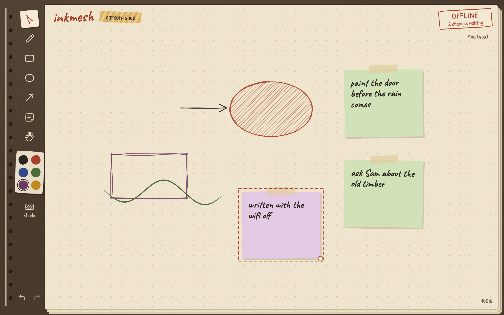
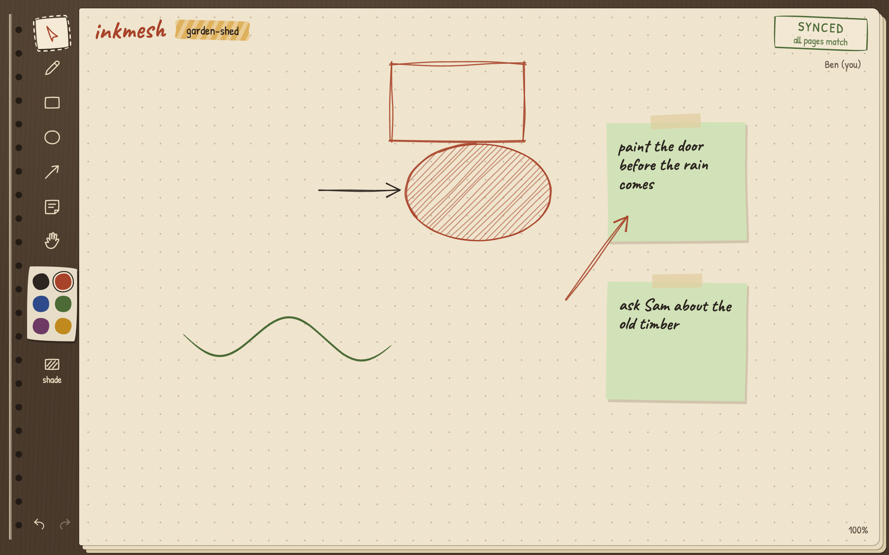
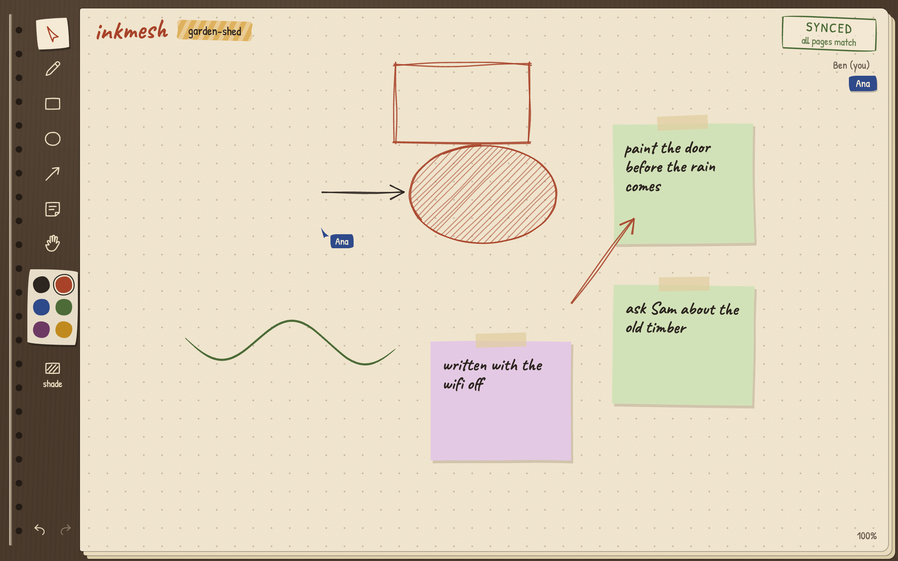
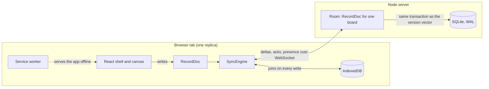
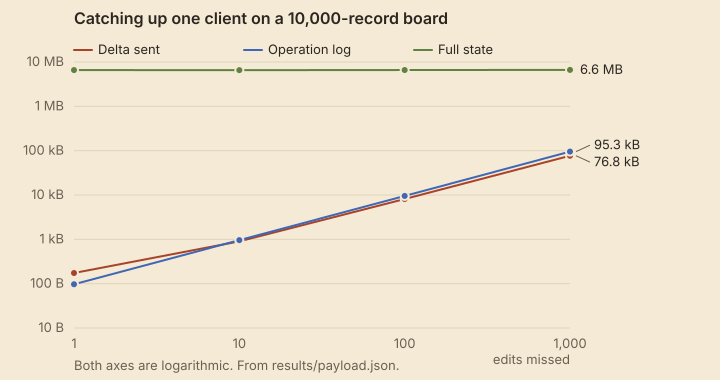
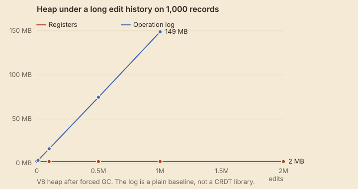

# inkmesh

[](https://github.com/matejpopovski/inkmesh/actions/workflows/ci.yml)

A shared sketchbook that keeps working when the network does not. Two people can draw on one page,
lose the connection, disagree about where a box belongs, and end up with the same page, pixel for
pixel, when the connection comes back. The conflict resolution is a CRDT written from scratch in
[`packages/crdt`](packages/crdt), with no dependencies and no Yjs or Automerge underneath.

These are real captures from the end-to-end run. Ana (left) has lost the network, and Ben (right)
has not. Both have moved the same box.

<p>
  
  
</p>

After Ana reconnects, both browsers hold this page. Ben moved the box later, so his position wins.
Ana's note and Ben's arrow touch nothing in common, so both survive. Ana's cursor is back too.



The result that matters most: **100,000 randomised schedules, 9.8 million actions, zero divergence**
([`results/convergence.json`](results/convergence.json)). The Playwright suite then checks the same
promise in two real browser contexts, down to comparing canvas pixels.

## What happens when two people disagree

| Ana does                 | Ben does                      | Result                                             |
| ------------------------ | ----------------------------- | -------------------------------------------------- |
| Moves a box              | Recolours the same box        | Both apply. They are different fields              |
| Moves a box              | Moves the same box, later     | Ben's position wins. Clock time decides            |
| Moves a box              | Deletes the box, at any time  | It stays deleted. Delete always wins               |
| Types in a note          | Types in the same note, later | Ben's text wins, whole. See Limitations            |
| Adds a shape on top      | Adds a shape on top           | Both are kept, in the same order on every replica  |
| Deletes a box, then undo | Edits it meanwhile            | The box returns as a new shape, without Ben's edit |

## Why this is harder than it looks

Merging two copies of a value is easy. The difficult parts are the ones that appear once a client
can vanish for a month and return.

**"Last write" needs a clock you can trust, and you have none.** A Lamport counter lets a device
that made a thousand offline edits outrank a person who edited a minute ago. Wall clocks disagree
between machines. inkmesh uses a hybrid logical clock packed into one JavaScript number, so a stamp
sorts by real time, while anything a replica has seen is still guaranteed to sort before what it
writes next. A laptop six hours fast can win a concurrent conflict, but it can never shadow an edit
made after someone saw its write. That property has its own test.

**Deleted things have to stay deleted, forever, without being stored forever.** Drop a tombstone too
early and a client that was offline sends the shape back from the dead. Keep them all and a board
that gets drawn on and erased grows without limit. Most of the design below exists for this one
problem.

**"Everything since we last spoke" must be computable with no log.** Keeping every operation is the
easy route to delta sync, but history then grows with every drag.

## How it works



A record is a set of last-writer-wins registers, one per field. Fields that must change together
share a register: `pos` holds `[x, y]`, because merging `x` from one person with `y` from another
would put a shape somewhere nobody chose.

Order is a [fractional key](packages/crdt/src/order-key.ts), a string that always has room for
another key between any two. Keys carry four random digits, because two people adding a shape to
the top while offline would otherwise compute the same key, leaving no key between them for a later
"move between".

A record's id is the stamp of its creation. That small choice is what makes compaction work. Each
record moves up a four-step lattice:

```
unseen  ->  live  ->  deleted (tombstone)  ->  forgotten
```

Merging only ever moves a record up, which is why merges commute and repeat safely. **Forgotten
takes no storage**: it is represented by absence plus a version vector that covers the record's id.
"I have seen this record and I do not hold it" can only mean it was deleted and compacted. So
compaction is not a special operation that risks breaking convergence. It is one more step up.

The catch is that a delta cannot express "this record is gone". So a replica that compacts raises a
`floor` vector. A peer whose version vector covers the floor has already seen every forgotten
tombstone and gets a delta as usual. A peer below it gets the full state, where absence does carry
meaning, and drops the record itself, including any offline edits to it.

A delta is computed, not replayed: it is every register whose stamp the peer's version vector does
not cover. Overwritten values no longer exist, so being offline for a week and for a second are the
same code path. Each delta names the state it builds on, and a replica refuses one that would leave
a gap and asks again.

### Decisions, and what they beat

- **State-based deltas over an operation log.** A thousand drags cost one register. The price is
  that there is no history to browse.
- **Delete is terminal.** A reversible `deleted` flag lets a restore race with compaction and
  diverge. Undoing a delete re-creates the shape under a new id instead.
- **Tombstones keep every delete stamp they see.** Keeping only the newest looks enough and is not.
  See below.
- **The IndexedDB store joins on write rather than overwriting.** Two tabs are two replicas sharing
  one store, so the store behaves like a third replica and neither tab can lose the other's work.
- **Replica ids live in slots guarded by a Web Lock.** Two tabs sharing an id would break the
  one-writer assumption and silently drop edits. A fresh id per load would be safe, but every
  session would add a version vector entry for good.
- **The server persists before it acks.** A crash can lose an unacknowledged edit, and the client
  still holds that one and pushes it again. It works the other way too: a server that loses its
  database is refilled by its clients, and a test proves it.
- **Plain JSON and a thin server.** No framework, just `node:http`, `ws`, `better-sqlite3` and `sirv`.

## How the tests earned trust

The first version of the fast-check simulator passed everything, in suspiciously little time.
Measuring what it generated showed schedules averaging 5 actions, with 0 gaps and 0 full syncs across
2,000 runs. The hard paths were never reached, because fast-check biases arrays short by default and
the model read each receiver's true vector, which no real sender can do.

Lengthening the schedules and giving senders the same optimistic belief the real client has found a
real bug within 168 runs: two concurrent deletes, one compacted, leaving the other replica with a
tombstone stamp no floor would ever cover. That is why tombstones are stamp sets. A test now fails
if the generator stops reaching gaps, full syncs and compaction.

To check that the suite can fail at all, [`bench/mutants.ts`](bench/mutants.ts) breaks the CRDT in
14 deliberate ways. The property suite alone catches 12 of them and the full
suite catches 14 ([`results/mutants.json`](results/mutants.json)).

The end-to-end suite got the same treatment by hand. Skipping the push on reconnect, turning off
local saves and unseeding the wobble each made it fail, and it passed 18 of 18 when repeated three
times. It drives real pointer input in two isolated browser contexts. Before relying on
`context.setOffline`, a probe confirmed that in this Chromium an open WebSocket stops carrying
traffic and new ones fail. The test also asserts that the other browser sees the person leave, and
one test kills the server with `SIGKILL` mid-session.

## Numbers

Run on an Apple M3 Max (14 cores, 36 GB), Node 20.20.2, with unrelated jobs sharing the machine, so
treat timings as indicative. Everything comes from `npm run bench` and lands in `results/`.

### Convergence

| Schedules | Actions   | Replicas | Delivered | Gaps refused | Full syncs | Compactions | Failures |
| --------- | --------- | -------- | --------- | ------------ | ---------- | ----------- | -------- |
| 100,000   | 9,814,487 | 2 to 5   | 1,298,233 | 122,126      | 53,343     | 76,364      | 0        |

The network loses, repeats and reorders messages, and clocks are skewed by up to 3 s. Every schedule
reached a fixed point within 2 rounds of reliable exchange. It took 43 s.

### Sync payload against state size



| Edits missed | Delta   | Delta, deflated | Operation log | Full state |
| ------------ | ------- | --------------- | ------------- | ---------- |
| 1            | 174 B   | 118 B           | 97 B          | 6.6 MB     |
| 10           | 901 B   | 245 B           | 959 B         | 6.5 MB     |
| 100          | 8.1 kB  | 1.4 kB          | 9.5 kB        | 6.6 MB     |
| 1,000        | 76.8 kB | 12.3 kB         | 95.3 kB       | 6.6 MB     |

The delta tracks the edits, not the board, which is the point. It is **not** much smaller than an
operation log here, though, and at one edit it is larger, because its envelope carries version
vectors. These edits mostly hit different records, and a log only loses when writes overlap. When
they do, the gap is large: 100,000 writes to one shape produce a 180 B delta against a 10.0 MB log
(`dragCoalescing` in [`results/payload.json`](results/payload.json)).

**The worst case is real.** Once a client falls below the floor, its catch-up on that board goes from
156 B to 6.6 MB, even if only one tombstone was compacted (`compactedRejoin`). The default retention
of 30 days makes this rare for clients that return within a month, but it does not make it cheap.

### Memory under long histories



Two million edits on 1,000 records hold the heap at 1.8 MB, the same as after ten thousand. The
baseline retains one JavaScript object per write and reaches 148.9 MB at one million. It is a plain
log, deliberately simple, and **not** a measurement of any real CRDT library, which would compress
far better.

Tombstones are the part that can still grow. Drawing and erasing 200,000 shapes costs 69.6 MB with
no compaction, about 365 bytes each, and stays at 2.4 MB with it.

### Latency

An edit reaches another replica in **42.0 ms at p50**, 44.2 ms at p95, 47.4 ms at p99 and 79.6 ms at
worst, over 2,000 rounds. This is one process on loopback with real sockets and SQLite, so it leaves
out any network, and nearly all of it is the deliberate 40 ms flush window. A client joining a board
of 10,000 records has it in 119 ms (15.8 ms for 1,000).

## Run it

Needs Node 20.19 or newer. These install, build and test from a clean clone:

```sh
npm ci
npm run build
npm test                          # 166 tests, a few seconds
npx playwright install chromium   # once, for the end-to-end suite
npm run test:e2e                  # 6 tests in two real browser contexts
```

To use it, start the server and open `http://127.0.0.1:41510`. Send the `/b/<name>` address to a
second browser, or open a private window. Data goes to `data/inkmesh.sqlite`.

```sh
npm start
```

For development, run `npm run dev:server` and `npm run dev:web` together and open
`http://localhost:41511`, which has hot reload. Vite binds the IPv6 loopback, so use that name rather
than `127.0.0.1`. The
service worker is only active in the built version.

| Setting                  | Default               |                                       |
| ------------------------ | --------------------- | ------------------------------------- |
| `PORT`, `HOST`           | `41510`, `127.0.0.1`  | Where the server listens              |
| `INKMESH_DB`             | `data/inkmesh.sqlite` | SQLite file                           |
| `INKMESH_RETENTION_DAYS` | `30`                  | Age at which tombstones are forgotten |

Reproduce the results with `npm run bench` (a few minutes) and `npx tsx bench/mutants.ts`. Recapture
the screenshots with `npm run screenshots`.

Keys: `V` pick up, `P` pencil, `R` box, `O` circle, `A` arrow, `N` note, `H` move the page, `[` `]`
send backward and forward, `{` `}` to back and front, `Delete` erases. Double-click a note to edit it.

## Limitations

- **Text does not merge.** A note is one register, so two people typing in it means one version
  wins whole and the other is gone. Character-level merging would need a sequence CRDT.
- **There is no authentication.** Anyone with a board's URL can read and write it, and a client can
  claim any replica id. Frames are validated, but a valid client can still write nonsense. Do not
  expose this server to people you do not trust.
- **Clock skew is bounded by nothing.** A client with a fast clock wins concurrent conflicts for as
  long as it is ahead, and nothing rejects stamps from the future.
- **Delete-wins loses work quietly.** Offline edits to a shape someone else deleted vanish on
  reconnect, with no notice.
- **Falling below the floor costs a full state**, as measured above. Compaction is all-or-nothing per
  peer, and there is no partial catch-up.
- **There is no history.** Overwritten values are gone by design, so no time travel, and undo is per
  tab and lost on reload.
- **Offline tabs do not see each other.** Two tabs of one browser merge through IndexedDB on the next
  load and through the server when online, but there is no live channel between them.
- **It is one server process.** Boards live in its memory while in use. Nothing here scales past one
  machine.
- **A sync costs time in proportion to the board.** Computing a delta scans every record, between 2.5
  and 7 ms at 10,000 records (`computeMs`), on each flush.
- **Selection is one shape at a time**, and strokes cannot be resized.
- **Tested in Chromium only**, on localhost. Firefox, Safari, touch input and a real lossy network
  have not been tried, and offline is simulated through `context.setOffline`.
- **CI runs the fast tests only.** The end-to-end suite needs a browser download, so it runs locally.
- **WebSocket compression is off**, although the deflated column shows it would help.

Fonts are Caveat and Patrick Hand, bundled through Fontsource under the SIL Open Font License.
